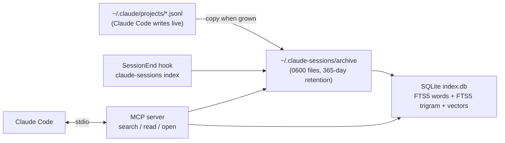

## Background

Most of my engineering work now happens inside Claude Code sessions: writing features, debugging, refactoring, reviewing PRs. Each of those sessions holds the *why* behind a decision, and I kept losing it.

Two things kept biting me:

1. **Claude Code deletes old transcripts.** By default, sessions older than 30 days are cleaned up at startup. By the time I needed "the session where we fixed that pool exhaustion", it was gone.
2. **Even when the transcript existed, I couldn't find it.** `claude --resume` shows a list of recent sessions. It doesn't let you search for "the chat where we talked about retrying failed webhook deliveries".

What I wanted:

- Keep **every chat for one year**, then delete it.
- **Local only.** No sync, no cloud, nothing leaves the laptop. Transcripts contain everything I paste, including secrets.
- Claude itself should use it. I say *"find the session where we did X"* and Claude searches. I say *"open it"* and the old session resumes beside me.
- Search should be **actually accurate**: any word, any part of a word, anything said anywhere in the chat, *and* things described in different words.

This post covers how I built that, including the parts that didn't work the first time.

> [!tip] Just want to use it?
> The code is on GitHub: [Mitrajit/claude-sessions](https://github.com/Mitrajit/claude-sessions). Paste this into Claude Code and it sets everything up, asking before it changes your settings:
>
> ```
> Clone https://github.com/Mitrajit/claude-sessions into ~/code/claude-sessions and follow its INSTALL.md exactly; show me the settings.json diff before applying it.
> ```

---
## Where Claude Code keeps your chats

Every session is a JSONL file, one JSON object per line, appended as the conversation happens:

```shell
~/.claude/projects/<project-folder-slug>/<session-uuid>.jsonl
~/.claude/projects/<project-folder-slug>/<session-uuid>/subagents/agent-*.jsonl
```

The project folder slug is the working directory with `/` replaced by `-`. Subagent work (research agents and the like) lives in a separate folder next to the session.

Retention is controlled by one setting in `~/.claude/settings.json`:

```json
{
  "cleanupPeriodDays": 365
}
```

That's the easy half of the retention requirement. The harder half is making sure the chats are also *searchable* and survive even if that setting changes later.

---
## The architecture



Four small pieces, all TypeScript on Node:

| Piece | Job |
|---|---|
| **Archive** | Mirrors every transcript into `~/.claude-sessions/archive/`, keeping the same folder name so a deleted transcript can be put back exactly where `claude --resume` looks for it. |
| **Index** | SQLite with FTS5 for exact search, plus a table of embeddings for search by meaning. |
| **MCP server** | Gives Claude three tools: `search_sessions`, `read_session`, `open_session`. |
| **SessionEnd hook** | Archives and indexes every session when it closes. |

Transcripts are append-only, so the sync rule is simple: if the source file is bigger than the archived copy, copy it again. Each archived file keeps the source's modification time, which doubles as "last activity" for the one-year retention:

```ts
if (!d || s.size > d.size) {
  fs.copyFileSync(src, dst);
  fs.chmodSync(dst, 0o600);
  fs.utimesSync(dst, s.atime, s.mtime); // archive mtime = last activity, used for retention
}
```

Every tool call also runs an incremental sync, so the hook is a safety net, not a requirement. If the terminal is force-closed and the hook never fires, nothing is lost: the transcript is still on disk and gets picked up on the next sync.

---
## Lesson 1: the transcript format is not what you think

The first version was written against sample data. When I pointed it at my real ~100 transcripts, I surveyed every entry type before trusting the parser:

```shell
python3 - <<'EOF'
import json, glob, collections
types = collections.Counter()
for f in glob.glob('*/*.jsonl'):
    for line in open(f):
        try: types[json.loads(line).get('type')] += 1
        except: pass
print(types.most_common())
EOF
```

That surfaced four surprises:

- **Titles** live in `{"type": "ai-title", "aiTitle": "..."}`, not in a `summary` entry. The first version showed no titles at all.
- **Prompts typed while Claude is busy** aren't `user` messages. They're stored as `attachment` entries of type `queued_command`. I had over a hundred of them, all invisible to search.
- **Noise disguised as user messages**: `<task-notification>`, `<bash-stdout>`, compaction summaries (`isCompactSummary`). All would have been indexed as things *I* said.
- **Subagent transcripts** are in a nested `subagents/` folder that a flat scan of the project folder misses.

The format is undocumented and changes between versions. That's why the project ships an `eval` command (more on that below) that I re-run after every Claude Code update.

---
## Lesson 2: measure search instead of guessing

"Is the search accurate?" is a question you can answer with numbers. I wrote an eval that samples text from a real session, searches for it, and checks whether that session comes back:

```ts
const id = pick(sessionIds);
const word = pick(words(pick(messagesOf(id))));
await check("1 word, anywhere in results", id, word, 500, "exact");
await check("start of a word (4 letters)", id, word.slice(0, 4), 500, "exact");
await check("middle of a word", id, word.slice(1, -1), 500, "exact");
```

Version 1 was plain SQLite FTS5 with Porter stemming:

| Test | v1 |
|---|---|
| One exact word, top 10 | 70% |
| One exact word, top 50 | 98% |
| Two words from different messages, top 10 | 70% |
| Start of a word (`postg` for `postgres`) | 12% |
| Middle of a word | 1% |

Two things stood out. First, matching was **per message**, so a chat where one word appears in message 3 and the other in message 40 failed the AND. That's exactly the "I talked about two things in the same chat" case. Second, anything other than a whole word matched almost nothing.

---
## Making exact search exhaustive

**Match per session, not per message.** Each search word is looked up independently, and a session matches when *every* word appears *anywhere* in it:

```ts
const per = terms.map((t) => termSessions(db, t));   // Map<sessionId, hits> per term
for (const id of new Set(per.flatMap((m) => [...m.keys()]))) {
  const hits = per.map((m) => m.get(id)).filter(Boolean);
  // a full match is hits.length === terms.length
}
```

**Substrings via a trigram index.** SQLite's FTS5 ships a `trigram` tokenizer that turns `MATCH` into a fast substring search. I keep a second FTS table with the same rows (same `rowid`) as the word index:

```sql
CREATE VIRTUAL TABLE chunks     USING fts5(session_id UNINDEXED, role UNINDEXED, ts UNINDEXED, text,
                                           tokenize = 'porter unicode61');
CREATE VIRTUAL TABLE chunks_tri USING fts5(text, tokenize = 'trigram');
```

A term matches a session through the word index (whole words, stemmed forms, `"term" *` prefixes) **or** the trigram index (any substring of 3+ characters).

**Index everything, weight it differently.** Command output, error messages and subagent work are now indexed too, but rank below the conversation itself:

```ts
const ROLE_WEIGHT = { title: 2, user: 1, assistant: 1, agent: 0.5, tool: 0.3 };
```

**Return everything.** Results come back with a total count and an `offset`, so "find *all* chats about X" is actually complete.

---
## Adding search by meaning, fully offline

Exact search can't find a chat about "401 after the auth session times out" when you search for "login token expiring". For that you need embeddings.

I used [`bge-small-en-v1.5`](https://huggingface.co/Xenova/bge-small-en-v1.5): small (34 MB quantized), good quality for its size, and runnable in Node via `@huggingface/transformers` (ONNX Runtime under the hood).

To keep the "nothing leaves the machine" promise, the tool **never downloads anything**. You fetch the model yourself, and remote loading is switched off in code:

```ts
const t = await import("@huggingface/transformers");
t.env.allowRemoteModels = false;              // never download; the model is installed by hand
t.env.localModelPath = modelRoot();
const extractor = await t.pipeline("feature-extraction", "Xenova/bge-small-en-v1.5", { dtype: "q8" });
const out = await extractor(texts, { pooling: "cls", normalize: true });
```

Two details are specific to BGE models: they use **CLS pooling** and expect a prefix on **queries only**, not on passages:

```ts
const QUERY_PREFIX = "Represent this sentence for searching relevant passages: ";
```

Messages are split into passages of about 1,000 characters and embedded once. Vectors are cached by the SHA-1 of the passage text, so re-indexing a session that grew only embeds the new messages. With ~3,000 passages, comparing every vector directly takes milliseconds, so there's no need for a vector database:

```ts
for (const [id, sid, buf] of db.prepare(`SELECT p.id, p.session_id, e.vec FROM pieces p
    JOIN emb e ON e.hash = p.hash`).raw().iterate()) {
  const v = new Float32Array(new Uint8Array(buf).buffer);
  let sim = 0;
  for (let i = 0; i < v.length; i++) sim += v[i] * q[i];   // normalized → dot product = cosine
  // keep the best passage per session
}
```

A quick sanity check on the model:

| Query | Passage | Similarity |
|---|---|---|
| how do I fix the login token expiring | 401 unauthorized after the auth session times out | **0.76** |
| how do I fix the login token expiring | recipe for banana bread | 0.48 |

**Calibrating the cutoff from data, not vibes.** Session titles are written by Claude Code in its own words, so they make natural paraphrased queries. Searching each title and recording how similar the right session was versus all the wrong ones:

| Cutoff | Right session kept | Wrong sessions per query |
|---|---|---|
| 0.60 | 100% | 44.0 |
| 0.65 | 100% | 21.3 |
| 0.70 | 100% | 5.6 |
| 0.75 | 92% | 1.0 |

I settled on **0.68**, slightly below the sweet spot, because real queries are vaguer than titles. I also made it adaptive: anything within 0.08 of a query's best match also counts, with a floor of 0.6.

---
## Lesson 3: hybrid search breaks on plain English

Both rankings are merged with **reciprocal rank fusion**: a session's score is the sum of `1 / (60 + rank)` across the exact and meaning-based lists. A session that ranks well in both rises to the top, and it doesn't matter that BM25 scores and cosine similarities are on different scales.

The eval numbers looked great. Then I typed a plain-English description of an old coding session, the way I'd actually ask for it, and the obvious session wasn't in the top five. Three separate bugs were hiding behind good averages:

1. **Filler words were search terms.** "a" matched every session as a prefix. **Fix:** drop stopwords unless quoted, and only match terms under 3 characters as whole words.
2. **Long sessions won everything.** A huge debugging session contains *every* common word somewhere, so it passed the "all words" rule and outranked short, relevant chats. **Fix:** BM25 at the session level. Rarer words count for more, repeats saturate, and scores are normalized by session length:

   ```ts
   const norm  = K1 * (1 - B + (B * sessionLen) / avgLen);
   const score = hits.reduce((n, x) => n + (x.idf * x.weight * (K1 + 1)) / (x.weight + norm), 0);
   ```
3. **Strict AND punished descriptions.** The relevant chats never used one of the words in my description. **Fix:** with 3+ terms, sessions missing one word are kept too, labelled `words 4/5`, and ranked by score.

The final unlock was **indexing each session's generated title** for both exact and meaning-based search. It's the best one-line summary of a chat that exists. The eval excludes titles so the paraphrase test stays honest.

After that, the keyword version of the same question returned every related session at the top of the list.

---
## The numbers, before and after

Measured on 73 real sessions with a fixed random seed:

| Test | v1 | Now |
|---|---|---|
| Any word: found anywhere in results | 98% | **100%** |
| Two words from different messages: found anywhere | — | **100%** |
| Start of a word | 12% | **100%** |
| Middle of a word | 1% | **100%** |
| Word from command output / subagent work | not indexed | **100%** |
| Session described in other words, top 10 | 86% | **100%** |
| Two words from different messages, top 10 | 70% | **80%** |

The "top 10 for one random word" number is around 60%, and that's fine. A word like "server" legitimately appears in 30 sessions, and there's no single right top 10. What matters is that every match is in the result set and Claude can page through them.

The MCP tool description also tells Claude to **search again with different wording** (error text, a table name, a hostname) when results look thin, before concluding something isn't there. A model that retries with better keywords turns out to be a big part of the accuracy story.

---
## Resuming a session: a split pane beside me

`open_session` restores the transcript if cleanup deleted it, then runs `claude --resume <id>` in the session's original directory.

A running Claude Code session can't switch itself to another session, so "open" has to start a new one. In tmux it opens a new window. In iTerm, it splits the exact pane I'm working in, found through `ITERM_SESSION_ID`, so there's no new window to hunt for:

```applescript
tell application "iTerm"
  set target to missing value
  repeat with w in windows
    repeat with t in tabs of w
      repeat with p in sessions of t
        if unique id of p is "<uuid from ITERM_SESSION_ID>" then set target to p
      end repeat
    end repeat
  end repeat
  if target is missing value then set target to current session of current window
  tell target to set pane to (split vertically with default profile)
  tell pane
    select
    write text "cd '<original dir>' && claude --resume <id>"
  end tell
end tell
```

Each Claude session starts its own copy of the MCP server, which inherits that session's environment. So the split always appears next to whichever session asked for it, even if another iTerm window is in front.

If you just want the old session's context *inside* the current one, `read_session` pages through the transcript instead.

---
## Setting it up

The one-liner above has Claude do all of this. By hand, it's:

```shell
git clone https://github.com/Mitrajit/claude-sessions ~/code/claude-sessions && cd ~/code/claude-sessions
npm ci && npm run build && npm install -g .
claude-sessions setup            # preview the changes for this machine
claude-sessions setup --apply    # make them (settings.json is backed up first)
```

`setup` exists so nobody (human or Claude) has to work out the config by hand. It adds this to `~/.claude/settings.json`, with the absolute paths for your machine filled in, and registers the MCP server:

```json
{
  "cleanupPeriodDays": 365,
  "hooks": {
    "SessionEnd": [{ "hooks": [{ "type": "command",
      "command": "/absolute/path/to/node /absolute/path/to/claude-sessions/dist/cli.js index" }] }]
  },
  "permissions": {
    "allow": ["mcp__claude-sessions__search_sessions", "mcp__claude-sessions__read_session"]
  }
}
```

`open_session` stays **off** the allow list on purpose, so launching a terminal still asks first.

For search by meaning, put these four files from the model's Hugging Face page into `~/.claude-sessions/models/Xenova/bge-small-en-v1.5/`:

```shell
config.json
tokenizer.json
tokenizer_config.json
onnx/model_quantized.onnx
```

Then embed existing sessions once (about 3 minutes for ~3,000 passages on an M-series Mac) and check the numbers:

```shell
claude-sessions index
claude-sessions eval
```

---
## Gotchas worth knowing

- **Use absolute paths for `node` if you use nvm.** Hooks and MCP servers don't always inherit your shell's `PATH`. `#!/usr/bin/env node` fails with `env: node: No such file or directory` when Claude Code isn't started from your shell. I found this by running the hook with `env -i PATH=/usr/bin:/bin`.
- **Never `console.log` in an MCP stdio server.** stdout *is* the protocol. Use `console.error`.
- **Pin and dedupe `zod`.** Two copies of zod (yours and the MCP SDK's) can make `tsc` run out of memory on `registerTool` types.
- **The index is disposable; the vectors aren't.** On a schema change I drop and rebuild every table except the embeddings, which are keyed by text hash and only depend on the model. A rebuild takes 2 seconds instead of 3 minutes.
- **Retention applies to the archive too.** It's easy to build an archive that keeps everything forever and quietly break your own retention policy. Archived sessions idle for 365 days are deleted along with their index rows and vectors.
- **Transcripts are plain text.** Anything pasted into a chat, including tokens and `.env` contents, sits in the archive for a year. Keep the folder `0700`.

---
## Takeaways

1. **Survey real data before trusting a parser.** Five minutes of counting entry types found four bugs that sample data never would have.
2. **Put a number on "accurate".** The eval turned vague worries into a table, and showed exactly where the next fix should go.
3. **Then test like a human anyway.** Good averages hid three ranking bugs that one plain-English query exposed immediately.
4. **Exact and semantic search aren't competitors.** Identifiers, IPs and table names need exact matching. Descriptions need embeddings. Reciprocal rank fusion gets you both with a few lines of code.
5. **Let the model help itself.** Telling Claude, in the tool description, to retry with different wording is the cheapest accuracy improvement in the whole project.
